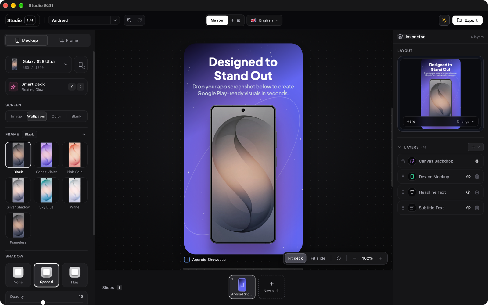
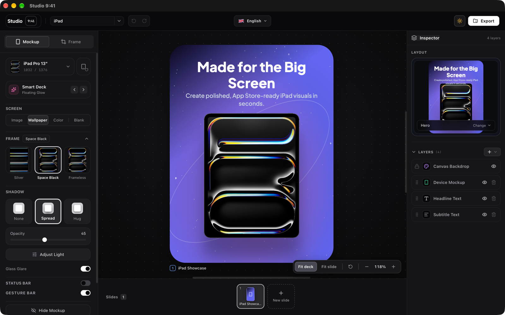
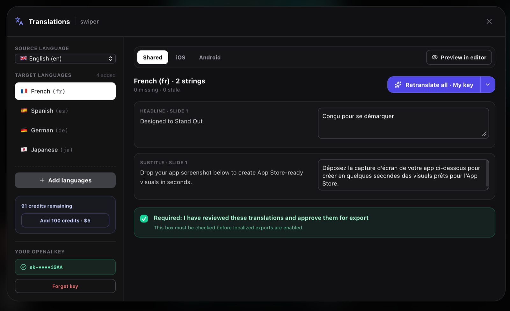
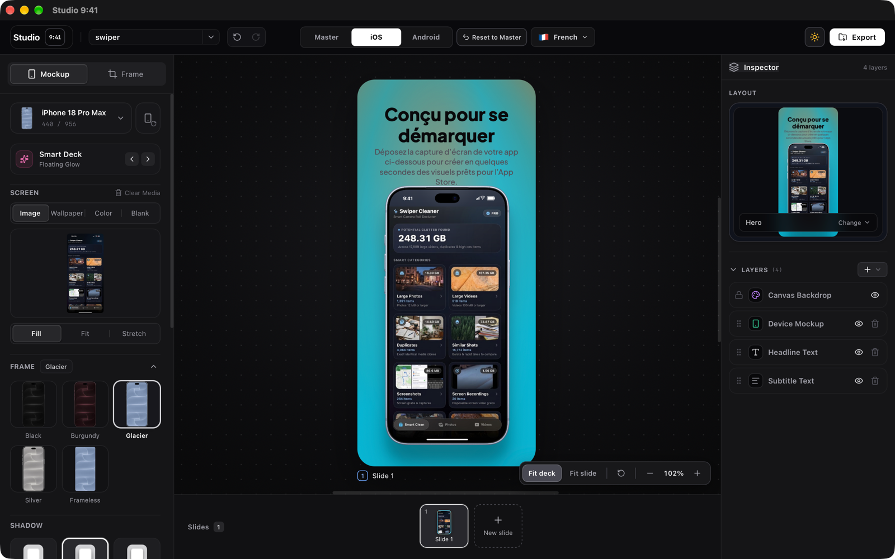

# Studio 9:41

### Design once. Ship everywhere.

**Create polished, localized App Store and Google Play screenshots from one private desktop studio.**

**Available for macOS and Windows**

  

Studio 9:41 brings device mockups, reusable layouts, panoramic decks, platform variants, AI localization, status-bar cleanup, and batch export into one native desktop app. Rendering and non-AI exports happen locally on your computer.

## Download Studio 9:41

Open the [latest release](https://github.com/burhanuddin20/studio941-releases/releases/latest) and choose the installer for your computer:

| Platform | Computer | Choose this asset | Verification |
| :--- | :--- | :--- | :--- |
| macOS | Apple Silicon — M-series chips | `Studio.941_*_aarch64.dmg` | Apple signed and notarized |
| macOS | Intel — x86_64 | `Studio.941_*_x64.dmg` | Apple signed and notarized |
| Windows | 64-bit — x64 | `Studio.941_*_x64-setup.exe` | NSIS installer, currently unsigned |
| Windows | Managed installation | `Studio.941_*_x64_en-US.msi` | MSI installer, currently unsigned |

  <a href="https://github.com/burhanuddin20/studio941-releases/releases/latest"><strong>Download the latest release →</strong></a>

> Windows may show an unknown-publisher or Microsoft Defender SmartScreen warning until Windows publisher signing is added.

## Everything in one workflow

- **Design once for every platform:** Start from a shared Master design and create linked iOS and Android versions only where they need to differ.
- **Build for phones, tablets, and desktops:** Use iPhone, iPad, Android, MacBook, iMac, and frameless device mockups.
- **Translate inside the project:** Generate, review, approve, and preview multiple languages before export.
- **Export complete store packages:** Select platforms, sizes, languages, and slides, then render the full set in one batch.
- **Keep your screenshots local:** Device composition, cleanup, resizing, and non-AI export run on your computer.

## One project, every platform

Each project can contain a shared **Master** plus linked **iOS** and **Android** versions. Platform designs inherit from Master until you override a device, layout, screenshot, text field, or style. Reset an override at any time to reconnect it to the shared design.

This makes it possible to keep one campaign visually consistent while using the right devices, store formats, and copy for each platform.

## iPhone, iPad, Android, and Mac mockups

Studio 9:41 includes realistic portrait and landscape mockups with multiple finishes, accurate screen masks, frameless options, lighting, shadows, and system controls.

| Family | Included examples |
| :--- | :--- |
| iPhone | iPhone 16, 17, and 18 families; iPhone Air; iPhone Duo; Pro and Pro Max models |
| iPad | iPad Pro 11/13-inch, iPad Air 11/13-inch, standard iPad, and frameless iPad |
| Android | Pixel 11 Pro, Galaxy S26 Ultra, Nothing Phone (4a) Pro, and frameless presentations |
| Mac | MacBook Pro 14/16-inch, MacBook Air 13/15-inch, MacBook Neo, and iMac 24-inch |

<table>
  <tr>
    <td width="50%"></td>
    <td width="50%"></td>
  </tr>
  <tr>
    <td align="center"><strong>Android and Google Play</strong></td>
    <td align="center"><strong>iPad and the App Store</strong></td>
  </tr>
</table>

### Mockup controls

- Position, scale, rotate, pitch, yaw, and roll.
- Device finishes and portrait or landscape orientation.
- Configurable shadows, depth, glass glare, and lighting.
- iOS and Android status bars, network indicators, battery state, and gesture bars.
- Custom macOS menu bars and window chrome.
- Image, wallpaper, color, and blank screen fills with fill, fit, or stretch behavior.

## Layout and design system

### Smart Deck styles

Apply complete visual directions such as Floating Glow, Editorial Split, Minimal Studio, Tilted Hero, Isometric Neon, Sunset Warmth, Cosmic Angle, Slate Mesh, Electric Cherry, Pure Focus, Soft Pearl, and Lagoon Split.

### Reusable compositions

Choose layouts including Hero, Device Only, Caption Below, Editorial Split, Angled Hero, Detail Crop, Side by Side, Depth Stack, Feature to Detail, Mirrored Pair, Boundary Hero, Panoramic Pair, and Mac-specific desktop arrangements.

### Layer-based editing

- Canvas backdrop, device, headline, subtitle, badge, and additional visual layers.
- Add, duplicate, reorder, hide, or remove slides and supported layers.
- Build continuous backgrounds across a multi-slide deck.
- Preview compositions before applying them.
- Control typography, alignment, opacity, colors, gradients, and positioning.
- Choose from 16 bundled typefaces including Plus Jakarta Sans, Inter, Instrument Sans, DM Sans, Manrope, Space Grotesk, Playfair Display, Syne, and Apple SF Pro.

### Status Bar Cleaner

Replace distracting status-bar content with a consistent 9:41 presentation. The standalone Quick Cleaner can also clean and download a single screenshot without creating a full project.

## Localization Studio

Translate and review store copy without leaving the project:

- Add one or several target languages.
- Translate all missing content or retranslate one language.
- Maintain shared copy plus iOS- and Android-specific translations.
- Detect missing or stale strings after source text changes.
- Review and approve generated copy before localized export.
- Preview any selected language in the editor.
- Choose Studio credits or your own OpenAI API key.

The built-in catalogue includes English, French, Spanish, German, Japanese, Simplified and Traditional Chinese, Italian, Portuguese, Korean, Arabic, Dutch, Russian, Turkish, Hindi, Indonesian, Vietnamese, Thai, Polish, Swedish, and Hebrew.

  

Translate once, then preview the localized design directly in the editor before export.

<table>
  <tr>
    <td width="50%"></td>
    <td width="50%"></td>
  </tr>
  <tr>
    <td align="center"><strong>English source design</strong></td>
    <td align="center"><strong>French localized design</strong></td>
  </tr>
</table>

### Two translation methods

| Method | How it works |
| :--- | :--- |
| Studio credits | Translation is processed through the Studio 9:41 service using only the source strings and locale guidance needed for the request. |
| Your OpenAI key | The desktop app sends the key and source text directly to OpenAI. The key stays in zeroizing memory for the current session and is never stored in the project, browser storage, OS vault, logs, or Studio 9:41 servers. |

Closing the app or selecting **Forget key** removes the session key.

## Store-ready batch export

Choose platforms, sizes, languages, and slides, then export individual PNG/JPG files or an organized ZIP archive.

| Destination | Supported presets |
| :--- | :--- |
| iPhone App Store | 6.9, 6.7, 6.5, and 5.5-inch portrait and landscape outputs |
| iPad App Store | 13, 12.9, and 11-inch iPad plus iPad mini portrait and landscape outputs |
| Mac App Store | 1280 × 800, 1440 × 900, 2560 × 1600, and 2880 × 1800 |
| Google Play | 1080 × 1920 phone portrait, 1920 × 1080 phone landscape, and 1024 × 500 feature graphic |
| Social and launch | Instagram, X, YouTube, Product Hunt, Dribbble, and common aspect ratios |

Localized output is organized by platform, language, and target size. Store artwork is flattened before export so App Store Connect and Google Play do not receive unsupported alpha channels.

## Projects and workflow

- Start from iPhone, Android, iPad, Mac, blank, or themed starter projects.
- Name, save, duplicate, switch, and delete local projects.
- Restore the active autosaved project when the app reopens.
- Undo and redo editing history.
- Work in a dark or light interface.
- Check for signed updates and install them from inside the desktop app.

## Free and Pro

The free editor includes the core design workflow, the iPhone catalogue, selected Android/iPad/Mac devices, frameless modes, local projects, and standard export tools.

Studio 9:41 Pro unlocks:

- The complete Android, iPad, and Mac device catalogues.
- Advanced Android status and system controls.
- Custom macOS menu-bar and window chrome.
- Linked Master, iOS, and Android project variants.
- Localization Studio and multi-language export.

## Private by design

- Screenshots, project names, device settings, and exported images stay on your computer.
- Rendering, device composition, status-bar cleanup, resizing, and non-AI export run locally.
- Customer OpenAI keys are desktop-only and session-only.
- Your own key goes directly from the Rust process to OpenAI and never passes through Studio 9:41 servers.
- Studio service credentials are stored by the backend and are never embedded in the desktop app.

## Installation

### macOS

1. Open the [latest release](https://github.com/burhanuddin20/studio941-releases/releases/latest).
2. Download the Apple Silicon or Intel `.dmg` for your Mac.
3. Open the DMG and drag **Studio 9:41** into Applications.
4. Launch Studio 9:41 from Applications.

Both macOS builds are Developer ID signed and notarized by Apple.

### Windows

1. Open the [latest release](https://github.com/burhanuddin20/studio941-releases/releases/latest).
2. Download the x64 `.exe` installer, or use the `.msi` on a managed system.
3. Follow the installer prompts.

Windows installers are currently unsigned and may trigger an unknown-publisher or SmartScreen warning. Some managed computers may prevent installation until publisher signing is added.

## Automatic updates

Studio 9:41 checks the public release feed shortly after launch. You can also select the version button in the app header to check manually. When a newer signed release is available, the app can download it, install it, and restart.

Files ending in `.sig` and `.app.tar.gz`, along with `latest.json`, support automatic updates. Most users should install Studio 9:41 using the `.dmg`, `.exe`, or `.msi` assets instead.

## Feedback and support

- [Download the latest release](https://github.com/burhanuddin20/studio941-releases/releases/latest)
- [Report a bug or request a feature](https://github.com/burhanuddin20/studio941-releases/issues)
- [Follow development on X](https://x.com/burhanuddin20)

---

**Create the store presence your app deserves.**

[**Download Studio 9:41 →**](https://github.com/burhanuddin20/studio941-releases/releases/latest)

